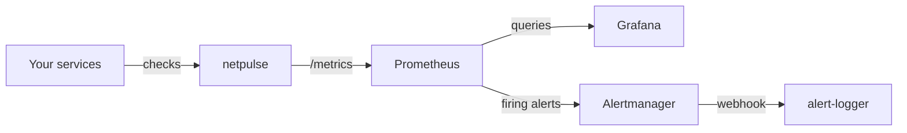

# homelab-observability

A complete monitoring stack that starts with one command: service checks, metrics, dashboards and alert routing, all defined as code.



| Service | Purpose | Address |
| --- | --- | --- |
| [netpulse](https://github.com/endrinjoo/netpulse) | Checks TCP, HTTP, DNS and TLS targets | <http://127.0.0.1:8000> |
| Prometheus | Stores metrics and evaluates alert rules | <http://127.0.0.1:9090> |
| Alertmanager | Groups and routes alerts | <http://127.0.0.1:9093> |
| Grafana | Dashboards, provisioned from files | <http://127.0.0.1:3000> |
| alert-logger | Prints alerts to its log | internal only |

## Quick start

You need Docker with Compose.

```bash
cp .env.example .env    # then choose a Grafana password
docker compose up -d --build
```

Log in to Grafana as `admin`. The **Netpulse overview** dashboard and the Prometheus data source are already set up.

## See an alert end to end

Stop a monitored service, then watch the alert travel through the stack:

```bash
docker compose stop grafana
docker compose logs -f alert-logger
```

After about two minutes (netpulse's failure threshold, plus the one minute the rule requires), you should see:

```text
[FIRING] critical NetpulseTargetDown: grafana is down
```

Run `docker compose start grafana` and a `[RESOLVED]` line follows.

## Alert rules

| Alert | Severity | Fires when |
| --- | --- | --- |
| `NetpulseTargetDown` | Critical | A target has been down for 1 minute |
| `NetpulseNotScraped` | Critical | Prometheus has been unable to reach netpulse for 2 minutes |
| `NetpulseHighLatency` | Warning | A target's p95 latency has been above 1 second for 10 minutes |
| `NetpulseCertExpiringSoon` | Warning | A certificate has under 14 days left, for 1 hour |

While a critical alert is active for a target, Alertmanager suppresses that target's warnings to reduce noise.

To send real notifications, replace the `alert-logger` receiver in [alertmanager.yml](alertmanager/alertmanager.yml) with email, Slack or another supported receiver.

## Design decisions

- **Everything is code.** Dashboards, data sources and rules are provisioned from files, so a rebuilt stack comes back identical.
- **Alert rules have unit tests.** `promtool test rules` checks that alerts fire when they should and stay quiet during a short blip.
- **The monitor is monitored.** If netpulse dies, its targets stop reporting, so `NetpulseNotScraped` covers that gap.
- **Secure defaults.** Ports only listen on localhost, image versions are pinned, and the Grafana password must come from `.env`. The stack refuses to start without one.

## CI

Each push runs three jobs:

1. **Static checks:** verify the wiring without Docker, for example that rules and dashboards only use metrics netpulse really exports.
2. **Config validation:** runs `docker compose config`, `promtool check config`, `promtool test rules` and `amtool check-config`.
3. **End-to-end test:** starts the whole stack, confirms Prometheus is scraping netpulse and confirms Grafana loaded the dashboard.

## Limitations

- It's a single-host setup, so Prometheus and Alertmanager aren't highly available.
- netpulse has no authentication of its own. Keep the ports on localhost, or add a reverse proxy with authentication before exposing them.

Licensed under MIT.
